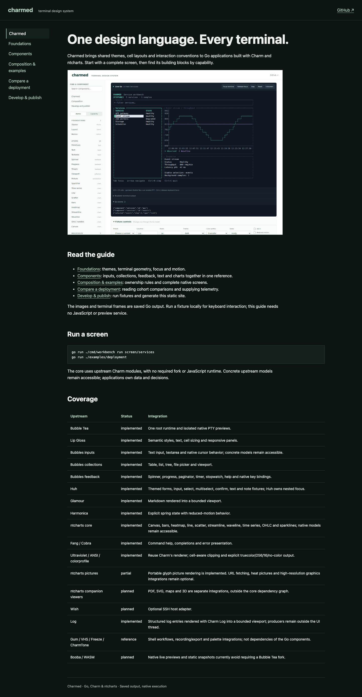

# Charmed

A Go design system for Charm and ntcharts, with a static reference guide and native terminal fixtures.

The [design philosophy](DESIGN.md) guides the visual language and component decisions. Components share semantic themes, terminal-cell geometry, focus conventions and state handling. The guide groups related components, saved Go output, source and composition examples by capability.



## Run it

Requires Go **1.26.11+**. Native terminal sessions support Linux and macOS.

```sh
go run ./cmd/workbench list
go run ./cmd/workbench run screen/services
go run ./cmd/workbench run screen/deployment --scenario isolated-hosts --sigma 3
go run ./cmd/workbench run screen/deployment --comparison-variant bands
go run ./cmd/workbench run chart/timeseries --theme light --series 3
go run ./cmd/workbench capture screen/services --plain
```

## Components

Go packages follow capabilities. Atomic levels organize the catalog.

| Package | Includes |
| --- | --- |
| `theme` | Dark, light, high-contrast and monochrome themes; semantic and dim colors; independent series colors; named glyphs, spacing, ASCII and motion policies |
| `layout` | ANSI-aware fitting, cell rectangles, responsive splits, stacks, panels, headers and footers |
| `navigation` | Keyboard-driven tabs with stable selection and overflow indicators |
| `interaction` | Focus scopes and typed selection/submission events |
| `input` | Bubbles text input, textarea, virtual cursor and labeled field composition |
| `collection` | Native tables, lists, trees, file pickers, viewports and bounded structured logs |
| `feedback` | Health, lifecycle and connection status atoms, attention indicators, spinner, progress, pagination, help, timers, stopwatch and Harmonica motion |
| `attention` | Optional one-sided or two-sided warn/error boundaries, explicit unknown/off states and typed transitions |
| `form` | Themed Huh forms with native nested focus and validation |
| `text` | Labels, badges, semantic pills, key hints and Glamour Markdown rendering |
| `chart` | Sparklines, time series, line/scatter, bars, heatmaps, streamline/waveline, OHLC, canvas, interval bands, cohort distributions, comparison panels and portable pictures |
| `diagram` | State transition diagrams with labeled directed edges, cycles, self-loops and initial/final/active markers |
| `cohort` | Validated interval counts, request-weighted rates and unweighted member sample spread |
| `pattern` | Service workbench and cohort comparison with linked plots, member selection and inspection |
| `runtime` | One root Bubble Tea terminal session |
| `story` | Deterministic Go fixtures shared by terminal execution, browser previews and snapshots |

Stateful wrappers expose their concrete upstream models or return them directly. Applications retain access to native APIs. Components return Bubble Tea commands; their parent forwards them. Application services and business decisions remain outside the UI library.

Exposing upstream APIs is a deliberate compatibility commitment. See the [architecture decision](ARCHITECTURE.md) for ownership boundaries and wrapper lifecycle responsibilities.

```go
// A field remains an ordinary concrete Go model.
field := input.NewText(input.TextOptions{
    Placeholder: "Environment name",
    Width:       40,
    Theme:       theme.New(theme.Dark),
})

// Forward this command from the owning model.
cmd := field.Focus()
```

The core uses upstream Charm v2 modules. It has no JavaScript runtime requirement and no Bubble Tea fork.

## Static guide

[Browse the guide](https://lanej.github.io/charmed/) by atomic category and capability group. Each component starts with the output of a compiled consumer example, followed by its Go usage and import links. Examples include their data and setup; package declarations and outer functions stay out of the page. Additional fixture variants remain in tabs, and implementation source is linked separately. CLI instructions remain in the development guide. See the [brand sheet](https://lanej.github.io/charmed/brand.html) for visual tokens and identity.

```sh
just docs
```

The generator writes `docs/dist/` using Go alone. GitHub Actions uploads this directory to Pages; the published guide uses ordinary HTML, CSS, images and links. It needs no npm or preview service. A tiny local script enhances keyboard-accessible variant tabs; without JavaScript all snapshots remain visible. Saved terminal frames preserve truecolor as static HTML, with separate 256-color, 16-color and monochrome fallback tabs; run a native fixture for keyboard interaction and animation. See [foundations](docs/foundations.md) for glyph, spacing and panel allocation contracts.

Edit the guides in `docs/*.md` and layout in `workbench/site/`. The registry supplies snapshots and source and validates declared component composition. See [development](docs/development.md), the [deployment guide](docs/deployment.md), and the [HTTP/log inspector API](docs/log-inspector.md).

## Coverage

The catalog covers the core Charm UI libraries and all ten core ntcharts chart families. Portable picture rendering is included. The generated coverage inventory distinguishes implemented components from optional extensions: SSH hosting, URL/high-resolution image integrations, companion PDF/SVG/map/3D viewers, and browser WASM execution.

WASM remains optional because the current Booba route requires a patched Bubble Tea replacement. The native runner and static export work independently of it.

## Verify

```sh
just check
just docs
```

Install [just](https://github.com/casey/just#installation) and [ShellCheck](https://github.com/koalaman/shellcheck#installing), then run `just` to list targets. `just check` uses the module's Go version by default and runs ShellCheck, module tidiness, strict lint and formatting, uncached race tests, and reachable-vulnerability analysis. The same target runs on Linux and macOS in CI, with ShellCheck pinned to 0.11.0. Existing Go lint and style findings are recorded in a shrinking baseline; new findings fail, and resolved allowances must be removed with `just ratchet`. Use `just shellcheck`, `just lint`, `just test` or `just vuln` for individual gates; `just lint` includes ShellCheck. Use `just fmt path/to/file.go` or `just fix ./path/to/package` for scoped fixes. `just run` starts the service fixture; pass a story ID and flags for another fixture.

Checks also exercise cell bounds, deterministic frames, focus and selection, resize, background updates, native process cleanup, static guide generation and component links.

MIT licensed. Upstream components retain their respective licenses.
