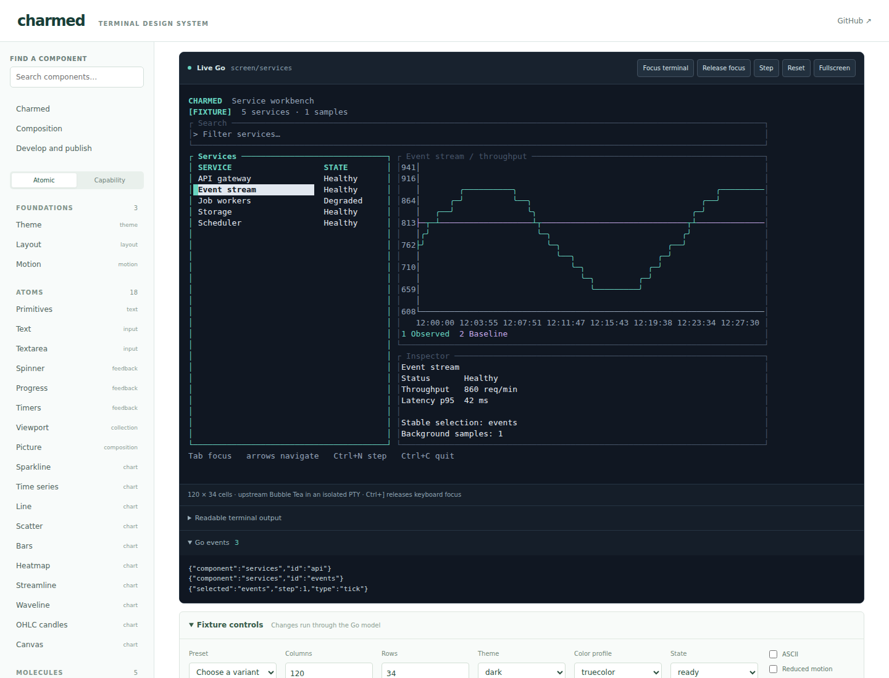

# Charmed

A Go design system for Charm and ntcharts, with a standalone MDX component workbench.

Components share semantic themes, terminal-cell geometry, focus conventions and state handling. The workbench provides the component-explorer concept: searchable examples, variants, controls, real terminal previews, emitted events and highlighted Go source. It uses Vite and MDX directly.



## Run it

Requires Go **1.26.8+**. The documentation app also needs Node **24+** and npm. Native live previews support Linux and macOS.

```sh
go run ./cmd/workbench list
go run ./cmd/workbench run screen/services
go run ./cmd/workbench run screen/deployment --scenario isolated-hosts --sigma 3
go run ./cmd/workbench run chart/timeseries --theme light --series 3
go run ./cmd/workbench capture screen/services --plain
```

Open the component workbench:

```sh
cd docs
npm ci
npm run dev
```

The catalog runs at **http://127.0.0.1:5173**. Its native preview service runs on loopback port 7331. Each live preview starts a fixed, registered Go story in its own pseudo-terminal. Closing or resetting a preview cancels and reaps its process.

Use **Focus terminal** to direct keys into a preview and **Ctrl+]** to release focus. **Tab** moves between regions in the service screen; arrow keys select rows; **Ctrl+N** advances fixture data. Resizing preserves the selected service.

## Components

Go packages follow capabilities. Atomic levels organize the catalog.

| Package | Includes |
| --- | --- |
| `theme` | Dark, light, high-contrast and monochrome themes; semantic color roles; ASCII and motion policies |
| `layout` | ANSI-aware fitting, cell rectangles, responsive splits, stacks and panels |
| `interaction` | Focus scopes and typed selection/submission events |
| `input` | Bubbles text input, textarea, virtual cursor and labeled field composition |
| `collection` | Native tables, lists, trees, file pickers, viewports and bounded structured logs |
| `feedback` | Spinner, progress, pagination, help, timers, stopwatch and Harmonica motion |
| `form` | Themed Huh forms with native nested focus and validation |
| `text` | Labels, badges, key hints and Glamour Markdown rendering |
| `chart` | Sparklines, time series, line/scatter, bars, heatmaps, streamline/waveline, OHLC, canvas, interval bands, portable pictures and chart compositions |
| `cohort` | Validated interval counts, request-weighted rates and unweighted member sample spread |
| `pattern` | Service workbench and cohort comparison with linked plots, member selection and inspection |
| `runtime` | One root Bubble Tea terminal session |
| `story` | Deterministic Go fixtures shared by terminal execution, browser previews and snapshots |

Stateful wrappers expose their concrete upstream models or return them directly. Applications retain access to native APIs. Components return Bubble Tea commands; their parent forwards them. Application services and business decisions remain outside the UI library.

```go
// A field remains an ordinary concrete Go model.
field := input.NewText(input.TextOptions{
    Placeholder: "Environment name",
    Width:       40,
    Theme:       theme.New(theme.Dark),
})

// Forward this command from the owning model.
cmd := field.Focus()
```

The core uses upstream Charm v2 modules. It has no JavaScript runtime requirement and no Bubble Tea fork.

## MDX workbench

The deployment comparison example shows all four HTTP response classes across blue and green fleets, nested 1/2/3σ host-spread bands, request-weighted histories and linked host inspection. Four synthetic scenarios distinguish a uniform regression, isolated bad hosts, unequal traffic and insufficient samples. Read **Compare a deployment** in the catalog for the count contract and statistical interpretation. The bands describe host variability; they are not confidence intervals or rollout decisions. Run `go run ./examples/deployment` for a standalone terminal application.

[View the deployment comparison](docs/assets/deployment.png).

The Go registry generates each component's MDX page, argument metadata, source excerpt and four standard saved variants: default, light, narrow and monochrome. The deployment comparison also saves its alternate scenarios for static browsing. Generated files live in `docs/generated/` and are excluded from Git.

An MDX page can compose the workbench directly:

```mdx
import { StoryCanvas } from '../components/StoryCanvas';
import { GoSource } from '../components/GoSource';

# Time series

Compare measurements over a shared time window.

<StoryCanvas storyId="chart/timeseries" />
<GoSource storyId="chart/timeseries" />
```

To build a static site:

```sh
cd docs
npm run build
```

Publish `docs/dist/` to any static host, including GitHub Pages. Hash routes work under a repository subpath. Static pages explicitly show **saved Go snapshots**. Live keyboard interaction and arbitrary fixture changes require the native service. Saved variants remain available offline.

## Coverage

The catalog covers the core Charm UI libraries and all ten core ntcharts chart families. Portable picture rendering is included. The generated coverage inventory distinguishes implemented components from optional extensions: SSH hosting, URL/high-resolution image integrations, companion PDF/SVG/map/3D viewers, and browser WASM execution.

WASM remains optional because the current Booba route requires a patched Bubble Tea replacement. The native runner and static export work independently of it.

## Verify

```sh
go vet ./...
go test -race ./...
cd docs
npm ci
npm run check
npm run build
npx playwright install chromium
npm test
```

Checks exercise cell bounds, deterministic frames, focus and selection, resize, background updates, native process cleanup, MDX source highlighting, live browser input and the static fallback.

MIT licensed. Upstream components retain their respective licenses.
