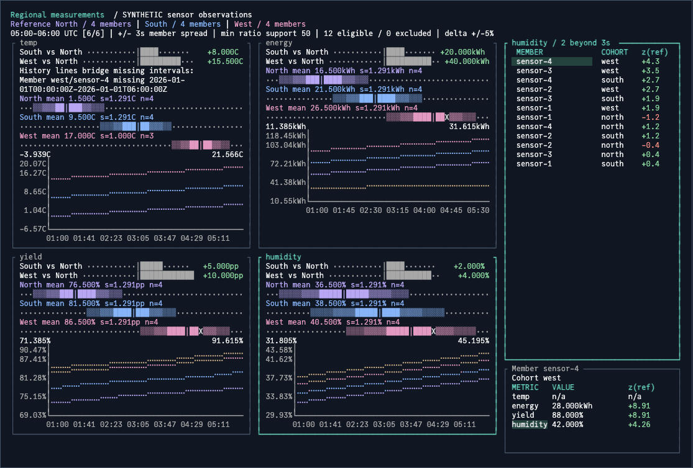

# Compare cohort measurements

`pattern.CohortComparison` accepts one or more cohorts with shared metrics and independent members. It links distributions, aggregate histories, selection and inspection. The regional example compares temperature, energy, yield and humidity; HTTP deployment comparisons remain a configured use case.



## Supply observations

A member is identified by `(CohortID, MemberID)`; matching IDs across cohorts do not imply pairing. Each ordered, nonoverlapping, equal-duration window contains at most one sample per member and cohort. Applications own telemetry retrieval, interval construction and any pairing policy; an empty window list is valid.

```go
metrics := []cohort.Metric{
    {ID: "temperature", Label: "Temperature", Kind: cohort.Scalar, Unit: "C"},
    {ID: "energy", Label: "Energy", Kind: cohort.Scalar, Unit: "kWh", Aggregation: cohort.Sum},
    {ID: "yield", Label: "Yield"},
}
sample := cohort.Sample{
    MemberKey: cohort.MemberKey{CohortID: "north", MemberID: "sensor-1"},
    Measurements: map[string]cohort.Measurement{
        "temperature": {Value: -5},
        "energy":      {Value: 12},
        "yield":       {Numerator: 85, Denominator: 100},
    },
}
```

Metric semantics separate aggregate behavior from member spread. Histories use the configured aggregate; distributions always show the unweighted member mean and sample standard deviation, including for sum metrics. Those bands describe member variation rather than uncertainty in the aggregate.

| Metric | Aggregate | Units and eligibility |
| --- | --- | --- |
| Scalar | Member mean by default; explicit `Sum` adds values | Configured unit; negative values allowed; present scalars are eligible |
| Ratio | Sum of numerators divided by sum of denominators | Percentages, possibly above 100%; deltas use percentage points |
| Ratio support | Low-volume members still contribute to aggregate | `MinSupport` limits denominator eligibility for spread |
| Overflow | Unrepresentable aggregate or spread becomes unavailable | Finite observations remain preserved; unrepresentable plot spans are labeled unavailable |
| Numeric labels | Magnitude-aware formatting | Tiny nonzero values and large values retain their magnitude |

History annotations identify missing time intervals for each affected cohort or selected member; connecting lines interpolate across those gaps. Missing observations are omitted from `Measurements`; explicit zero remains observed zero. A zero numerator and denominator represents an observed unavailable ratio, while a nonzero numerator without a denominator is invalid. Members remain selectable when the active metric is absent, and their inspector shows `n/a`.

## Select a reference

Set `ReferenceID` to compare every other cohort against that identity. Reordering never changes the baseline. Omit it, or call `SetReference("")`, to show distributions and histories without relative deltas or distances. A single cohort is valid with or without a reference and has no peer deltas.

| Operation | State and validation |
| --- | --- |
| `SetReference` | Reject unknown IDs; empty disables relative comparisons |
| `SetData` | Copy validated input; reject removal of an active reference until changed or cleared |
| Valid update | Retain member, focus, variant and historical window when their data still exists |
| Invalid update | Preserve current data and UI state |
| Tab to metric viewport | Scroll to additional cohorts, metrics and histories in either presentation |

Optional boundaries remain metric-specific. Compatibility fields `Hosts` and `Fleet` mean member z-distance and aggregate delta respectively. `Attention(metricID)` combines all members and the worst peer aggregate assessment; `Comparisons(metricID)` returns independent assessments keyed by peer cohort ID.

Configured policies without sufficient observations or a reference report `Unknown`; unconfigured policies remain `Off`. Missing member measurements receive unknown configured attention. Sigma bands and distances remain descriptive, not significance tests or application decisions.

## Migrate existing callers

Existing `Requests`/`Counts` samples and `cohort.Analyze` retain their count-based contract: every metric needs an explicit interval count no greater than requests. Use that representation or a non-nil `Measurements` map per sample; mixing them is rejected. `AnalyzeMetric` expects validated data and returns generic `Value`/`HasValue` alongside legacy `Rate`/`HasRate` aliases.

| Previous contract | Migration |
| --- | --- |
| First of two cohorts implicitly defines reference | Set `ReferenceID` explicitly; supply one to N cohorts |
| `MinRequests` | Compatibility alias for `MinSupport`; larger threshold applies when both are set |
| Selection event has singular `candidate` | Read complete `cohorts` ID list and optional `reference` |
| Typed attention transition | `Candidate` identifies the particular peer assessed |
| HTTP-specific labels | Cohort, metric, value and member labels apply across domains |

Native table and viewport access remain available. Data, reference, metric, window and size changes rebuild generated rows, columns, charts and inspector sizing; direct mutations to those properties reset. Apply customizations after those operations, and forward lifecycle commands on the Bubble Tea update thread.
