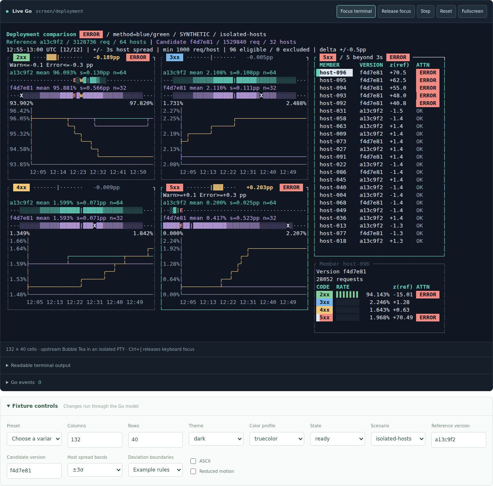

# Compare a deployment across a fleet

Four linked panels compare **2xx, 3xx, 4xx and 5xx response percentages** between version identifiers `a13c9f2` and `f4d7e81` during a **blue/green deployment**. Reference and candidate are comparison roles; blue/green describes the deployment method. The counts are synthetic: 64 hosts serving the reference version, 32 serving the candidate, and twelve five-minute windows.




## Presentation variants

**Stacked is the default.** Press **b** in the native terminal to switch to **Disconnected bands**. Changing it keeps the current host, metric, window, sigma, focus and attention policy. **b** toggles presentation natively; `SetVariant(pattern.Stacked)` and `SetVariant(pattern.Bands)` select it explicitly.


The band variant composes the same distributions and labeled peer-delta rows into a rectangle, with the active class's history below it. Each class retains a percentage axis shared by both versions. Static exports save **Disconnected bands** alongside the default stacked fixture, rather than publishing a replacement screen. Native: `go run ./cmd/workbench run screen/deployment --comparison-variant bands`.

## Read the comparison

The comparison separates request-weighted fleet behavior from equally weighted host distributions. Read both before interpreting a release difference: unequal traffic can change the fleet rate without shifting the typical host. Shared scales remain stable when selecting a different host or time window.

| Measurement | Interpretation |
| --- | --- |
| Fleet rate | Total class responses divided by all responses; high-volume hosts contribute proportionally more |
| Peer delta | Candidate minus reference in percentage points; negative extends left, positive right |
| Delta domain | One symmetric domain across all windows and fleet limits; selection does not rescale it |
| Host mean | Equal weight for every eligible host |
| Distribution bands | Mean plus/minus one, two and three sample standard deviations, using n minus one |
| Marks | Brightest inner band is one sigma, vertical bar is mean, X is selected host |
| Distribution domain | Shared by both versions within a class; includes full three-sigma extents and selected host; ratios can extend beyond zero and one hundred percent |
| History | Request-weighted version rates and selected host rate across supplied windows |
| Host ranking | Configured attention first, then absolute distance from the reference host distribution |
| z(ref) | Host rate minus reference mean, divided by reference spread; descriptive distance, never confidence |
| HTTP tones | Green 2xx, blue 3xx, amber 4xx, red 5xx; category color does not itself declare a regression |

Version IDs are opaque commit, release or build identifiers. Reference and candidate roles remain independent of deployment method, environment and host identity. Tail counts include eligible hosts from both cohorts beyond the selected sigma distance; candidate spread never redefines the reference distribution.

## Try distinct failure shapes

Pass `--scenario` to the native runner. Saved monochrome snapshots of these scenarios appear on the examples page.

| Scenario | What changes | What to inspect |
| --- | --- | --- |
| `isolated-hosts` | Five candidate hosts develop elevated 5xx rates after the fourth window | The candidate's wider spread, the ranked hosts and their histories |
| `uniform-regression` | Every candidate host develops a higher 5xx rate | The shifted candidate mean with relatively narrow spread |
| `unequal-traffic` | Host error propensities are similar, while the versions receive different volumes on the higher-error hosts | A weighted fleet delta without a comparable host-mean shift; this is workload confounding |
| `insufficient-samples` | Most hosts serve fewer than 1,000 requests; some serve none | Excluded host counts, `n/a` spread and the absence of finite z-scores |

| Native control | Result |
| --- | --- |
| Up / Down in hosts | Select the host |
| Left / Right | Select the time window |
| Brackets | Choose the active response class |
| 1 / 2 / 3 | Select visible spread and descriptive distance threshold, independently of attention policies |
| Tab | Move focus among host list, metric panels and inspector |
| Inspector arrows | Change active metric while retaining the selected host |
| Ctrl+N | Advance the window and wrap to the first |
| Resize | Retain host, metric, window and band limit; stack regions and scroll metrics when small |

The member inspector combines exact rates with percentage bars on a fixed zero-to-one-hundred scale. Small rates may fall below bar resolution while retaining their numeric value. CLI flags select the initial scenario and sigma; all four response classes remain available in narrow terminals.

## Optional warning and error boundaries

The `--boundaries` flag enables illustrative policies; `--boundaries=false` removes them. The library has no default alert thresholds. With no configured rule, deviation remains descriptive: there is no warning, error or implied healthy state. Saved snapshots include a **No boundaries** variant.

| Scope | Measurement | Example warning | Example error |
| --- | --- | --- | --- |
| 2xx host | Host `z(ref)` | ≤ −2σ | ≤ −3σ |
| 5xx host | Host `z(ref)` | ≥ +2σ | ≥ +3σ |
| 2xx fleet | Candidate minus reference weighted rate | ≤ −0.1 percentage points | ≤ −0.3 percentage points |
| 5xx fleet | Candidate minus reference weighted rate | ≥ +0.1 percentage points | ≥ +0.3 percentage points |

Each metric, scope, severity and side is optional. Host policies apply to eligible hosts in either version. Fleet policies compare the two request-weighted rates and require at least the configured minimum request count in each version. Equality triggers a boundary; error takes precedence over warning. Missing or insufficient measurements produce **UNKNOWN**, rather than a normal result. Host sigma rules remain unknown when reference spread is zero or unavailable; fleet percentage-point rules can still evaluate when their counts are available.

The attention indicator composes the shared pill component. It appears on the screen and metric heading, affected host rows and inspector values. The delta property uses the fleet attention tone; its metric badge shows the strongest fleet or host state. A metric's indicator shows the strongest fleet or host attention; the inspector preserves the individual results. HTTP status-category pills keep their separate meanings: a red **5xx** category does not itself raise an **ERROR** attention state.

`W` and `E` mark configured host warning and error boundaries on the distributions. The shared axis includes valid boundary positions. At terminal resolution, coincident markers show the stronger error marker; `X` takes priority for the selected host. Fleet limits appear directly on metric cards with full warning/error labels. Host limits are supplied by the application policy and marked on the bands. The 1/2/3σ controls change displayed bands and descriptive tail counts independently of attention policies. Supply explicit policies as shown below.

```go
// Host limits are in z(ref) units; fleet limits are in percentage points.
rules := map[string]cohort.ComparisonPolicy{
    "5xx": {
        Hosts: attention.Rule{
            Warn:  &attention.Bounds{Upper: attention.Limit(2)},
            Error: &attention.Bounds{Upper: attention.Limit(3)},
        },
        Fleet: attention.Rule{
            Warn:  &attention.Bounds{Upper: attention.Limit(0.1)},
            Error: &attention.Bounds{Upper: attention.Limit(0.3)},
        },
    },
}
err := screen.SetBoundaries(rules)
```

`SetBoundaries` validates and copies rules before changing the screen. Set a lower limit to watch decreases, set both sides for two-sided attention, or omit a severity or scope. Pass `nil` to remove all policies. Invalid or inverted limits leave the existing screen intact. These policies express application attention, rather than statistical confidence or an automatic deployment action.

The optional callback emits typed `attention.Changed` events when a metric's **hosts** or **fleet** attention level changes, including recovery and removal of a policy. It seeds the initial state without emitting a burst of events. Rendering, resizing and changing the displayed sigma do not emit attention transitions.

## Sampling and interpretation

| Sampling condition | Interpretation |
| --- | --- |
| At least 1,000 requests per host/window | Eligible for the example's host mean and spread |
| Lower-volume hosts | Excluded from host distributions but actual counts still contribute to fleet rates |
| Zero requests | Unavailable rate, never zero percent |
| Fewer than two eligible hosts | Sample standard deviation unavailable |
| Zero or unavailable reference spread | z(ref) is unavailable |
| Missing versus zero counts | Reject absent metric counts; accept explicit zero observations |

These bands describe host variation. They are **not confidence intervals**, do not imply 68/95/99.7% coverage for skewed host distributions, and do not determine whether a release is safe. Rare 5xx counts and unequal traffic need count-aware inference and a model of host and traffic heterogeneity. Repeated comparisons across hosts, classes and windows also need a decision policy that accounts for false positives. No automatic promote or rollback action is attached to these plots.

Compare both versions over overlapping, equal-duration intervals and comparable route, region, instance and request populations. The example treats the versions as independent host cohorts; it does not invent host pairing. A blue/green cutover with no overlapping traffic provides a before/after comparison, with time and workload as potential confounders. The four response classes partition responses in this fixture, so their changes are related; a 3xx or 4xx increase is not automatically a regression.

| Interpretation reference | Use |
| --- | --- |
| [NIST proportion control charts](https://www.itl.nist.gov/div898/handbook/pmc/section3/pmc332.htm) | Understand count-aware monitoring of proportions |
| [NIST exact binomial confidence limits](https://www.itl.nist.gov/div898/software/dataplot/refman2/auxillar/exacbici.htm) | Distinguish uncertainty about rates from host dispersion |
| [Google SRE canarying](https://sre.google/workbook/canarying-releases/) | Frame release comparisons and decision policy |

## Compose the reusable pieces

Signed values use `text.SignedNumber`. Its `SignTones` configure positive, negative and zero independently of warning/error boundaries. In this example, rising 2xx is green and falling 2xx is red; 5xx reverses those colors. Redirect and client-error changes use a direction-only tone because their benefit requires application context. Missing and non-finite observations render `n/a`; tiny nonzero values retain their sign rather than rounding to zero. Numeric color describes direction policy, while attention labels and the delta bar describe configured severity.

`text.Pill` separates semantic tone from `text.Bright`, `text.Normal` and `text.Dim` emphasis. `feedback.Status` supplies reusable `OK`, `WARN`, `ERROR`, `UNKNOWN`, `OFF`, `PENDING`, `RUNNING`, `PAUSED` and `DISABLED` states. `feedback.Attention` composes these display atoms after rule evaluation; it keeps unconfigured attention absent rather than implying an OK state. The component reference groups signed numbers, pills and statuses under their capabilities, with saved emphasis variants.

| Layer | Component | Responsibility |
| --- | --- | --- |
| Atom | `chart.IntervalBand` | Draw caller-supplied nested intervals and observation markers with ntcharts canvas |
| Atom | `text.Pill` | Render a labeled semantic tone, with theme-aware contrast and a text fallback |
| Atom | `text.SignedNumber` | Preserve exact sign and units with configurable sign tones, neutral missing values and emphasis |
| Atom | `feedback.Status` | Render labeled health and lifecycle states with shared tone and emphasis |
| Molecule | `feedback.Attention` | Compose a labeled warning/error/unknown/normal state from the shared pill |
| Molecule | `chart.DeltaProperty` | Compose a merged, signed title-bar comparison from the interval atom |
| Molecule | `feedback.PercentBar` | Compose native progress and an exact percentage as a dense table cell |
| Molecule | `chart.DistributionComparison` | Compose mean/spread labels, interval bands, boundary markers and a shared axis |
| Molecule | `chart.BandMatrix` | Compose disconnected distribution rows as a presentation variant |
| Organism | `chart.ComparisonPanel` | Compose the summary, distribution comparison and native time-series history |
| Analysis | `cohort.Analyze` | Calculate weighted rates and unweighted sample spread from interval counts |
| Policy | `attention.Rule` and `cohort.Assess` | Evaluate optional numeric boundaries separately from rendering and count aggregation |
| Organism | `pattern.CohortComparison` | Coordinate distributions, time series, host selection, focus, windows and responsive layout |
| Screen | `examples/deployment` | Supply version IDs, the deployment method, HTTP status tones, synthetic counts and the sample threshold |


```sh
go run ./examples/deployment
go run ./cmd/workbench run screen/deployment \
  --scenario uniform-regression --sigma 2 \
  --reference-version release-42 --candidate-version build-43
```

## Supply real telemetry

Replace `fixture.Data` with validated `cohort.Data` from the application's telemetry adapter. Version identity, interval counts and matched populations must remain explicit before the UI can support a meaningful comparison.

| Input | Contract |
| --- | --- |
| Cohort | Actual version ID, independent of deployment method or pool; aggregate hosts serving that version across environments |
| Reference | Set `ReferenceID` explicitly; cohort order does not select comparison roles |
| Member | Version/cohort ID and host ID, with interval request and response-class counts |
| Windows | Inclusive start, exclusive end; ordered, nonoverlapping equal durations; gaps and absent hosts allowed |
| Adapter | Convert cumulative counters and handle resets; supply matched route, region and request populations |
| Presentation | Application supplies `MetricTones`; the organism has no built-in HTTP status policy or telemetry queries |

Call `SetData` on the Bubble Tea update thread when new data arrives. Invalid updates return an error and preserve the existing screen. Valid updates copy the data and retain the selected host where it still exists. Appending windows follows the latest window only when it was already selected; inspecting an older window keeps that window selected. For comparisons scoped to a route or region, supply that matched population and label it in `Scope`.

The optional `Emit` callback reports member selection, time window, active metric, band-limit changes, presentation variants and attention transitions. Selection events include all cohort IDs and the optional reference; typed attention transitions identify the particular peer in `Candidate`. Applications own statistical inference, notification delivery and deployment decisions. Supply `MetricSigns` independently of `MetricTones` and `Boundaries` when composing your own domain.

For scalar measurements, additional cohorts, optional references and API migration details, see [Compare cohort measurements](cohorts.html).
