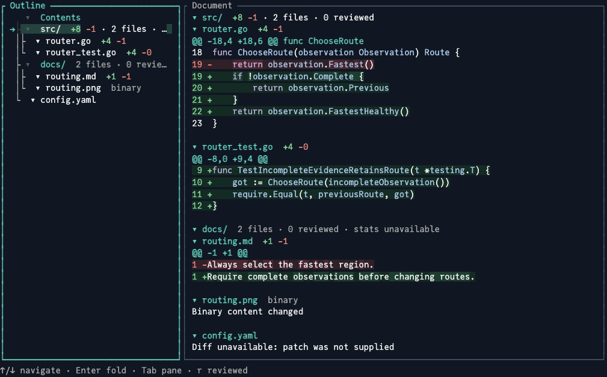

# Linked outlines and diff review

Use [Outline document](organisms-collection.html#pattern/outline-document) for any ordered hierarchy with linked content: proposals, observations, requests or files. The outline and document share depth-first order. Selecting an entry reveals its section; scrolling the document tracks the active outline entry without moving keyboard focus. A collapsed group becomes one summary and retains its descendants' independent fold states.

| Starting point | Input and ownership |
| --- | --- |
| `collection.NewSectionStack` | Ordered `DocumentSection` values, optional children and width-aware body renderers; one native scrolling viewport |
| `pattern.NewOutlineDocument` | The same sections as `OutlineEntry` values; native tree navigation, linked scrolling and shared folding |
| `gitui.NewDiffReview` | `ReviewEntry` values with supplied diffs, optional statistics, labels and groups |
| `gitui.NewFileDiffReview` | `ReviewFile` values; the optional helper creates directory groups from slash-separated paths without reading a filesystem |

Run `go run ./examples/review` for file review or `go run ./examples/review -document` for a document with no file concepts. Both examples own their Bubble Tea loop, route Tab between panels, enable mouse events and resize the existing model. The [diff review example](organisms-git.html#git/review) shows complete consumer setup with explicit item identities and supplied patches.

## Interaction and reviewed state

| Input | Behavior |
| --- | --- |
| Up / Down, j / k | Move through the outline or scroll the focused document |
| Enter | Fold or reopen the active section; scrolling updates the active entry |
| Left / Right, h / l | Collapse or expand the active section |
| Home / End, G | Go to the first or last entry, or the document's top or bottom |
| Page Up / Down, Ctrl+U / Ctrl+D | Page or half-page navigation in the focused panel |
| Tab / Shift+Tab | Switch panel focus in the runnable examples; parent-owned in the library |
| Click outline entry | Reveal its section; clicking a group also toggles the subtree |
| Click document heading | Fold or reopen that section |
| Wheel | Navigate or scroll the panel under the pointer |
| r in diff review | Toggle the active leaf's reviewed mark; groups are not marked |

Marking a file reviewed folds its body. Reopening the body preserves the reviewed mark; clearing the mark opens the body. Selecting a folded file reveals its heading without opening it. `ReviewedIDs` returns marks in document order, including hidden files, for application-owned persistence. Restore marks on new entries through `ReviewEntry.Reviewed` or `ReviewFile.Reviewed`; apply later mark changes through `SetReviewed`.

`SetEntries` copies nested diff data and rejects invalid identities before replacement. Retained IDs keep state. Changed hunk headers, lines, diff state or unavailable reasons clear the affected mark and open that leaf, while ancestor folds still apply. Label, path and statistic updates retain state. Supply `ContentRevision` when changes are not represented by patch data, especially binary or unavailable content; changing this opaque token also clears the mark. Without a changed patch or revision token, underlying changes are undetectable. Removed identities lose their state. Distinct review IDs allow staged and unstaged versions of one path to coexist.

## Diff presentation

Diffs use one dynamically sized line-number gutter by default: context and added rows show the new number; deleted rows show the old number. Green addition signs and red deletion signs retain their meaning while source text receives syntax colors over change surfaces; changed words receive stronger emphasis. File viewers infer the language from the supplied filename; unknown languages remain readable plain text. Tree statistics color additions green and deletions red, with aggregate counts placed before group metadata.

| `gitui.DiffOptions` | Presentation |
| --- | --- |
| Default options | Single gutter and filename-aware syntax highlighting |
| `Gutter: gitui.DualGutter` | Separate old and new line-number columns, sized to the actual numbers |
| `Gutter: gitui.AutoGutter` | Single or dual columns according to shifted old/new positions |
| `Language: "go"` | Explicit lexer override, useful for generated content or standalone `DiffHunk` calls |
| `DisableSyntax: true` | Neutral source text with distinct colored diff signs |

Pass options after the theme to a diff viewer or review constructor. `DiffReview.SetDiffOptions` refreshes cached bodies without resetting marks, folds or selection; direct viewer option changes take effect on `SetDiff`. Old and new fragments are tokenized independently within each hunk, preserving multiline comments and strings across supplied lines. Missing source outside the hunk can limit lexical accuracy. Source controls remain visible escapes; highlighting never reconstructs the whole file.

## Lifecycle and customization

The composition preserves the top visible section and its relative rendered row through folding, replacement and resize where possible. Hidden sections anchor to their nearest visible ancestor; removed sections use a surviving ancestor or preceding section. Native viewport clamping applies near the document's end. Body renderers are cached until data replacement, width changes or `Document.Refresh`; captured application data must remain stable until that refresh.

| Native surface | Retained and managed behavior |
| --- | --- |
| `Outline` | Styles, enumerators and bindings survive updates; nodes are rebuilt after replacement, width changes and folding |
| `Document.Viewport` | Native styles and bindings survive; content, dimensions, soft wrapping and vertical anchors belong to the stack |
| `SetKeyLayout` | Apply standard or Vim presets once, then customize native bindings; resize never reapplies presets |
| `SetOrigin(x, y)` | Set the screen cell where the composition starts before forwarding screen-coordinate mouse messages |
| `Document.Refresh` | Re-render bodies after caller-owned presentation changes; call `SyncScroll` after direct native scroll changes to synchronize selection |

Ancestor rails use one cell and cap at two levels by default, with a smaller cap when space is tight. `SetIndentDepth` adjusts this presentation without changing ancestry or folding. Keep customized native node geometry on one rendered row for mouse hit testing. Body content wraps by terminal-cell width before calculating offsets. Wide layouts place the navigator beside the document; widths below 80 cells stack it above, with keyboard access to hidden content.

File statistics are optional observations. Group totals show additions and deletions only when every descendant supplies valid textual statistics; binary or unavailable comparisons keep totals explicitly unavailable. Applications own patch collection, review persistence and repository operations. The library renders supplied content and maintains local interaction state without fetching data or changing a repository.
