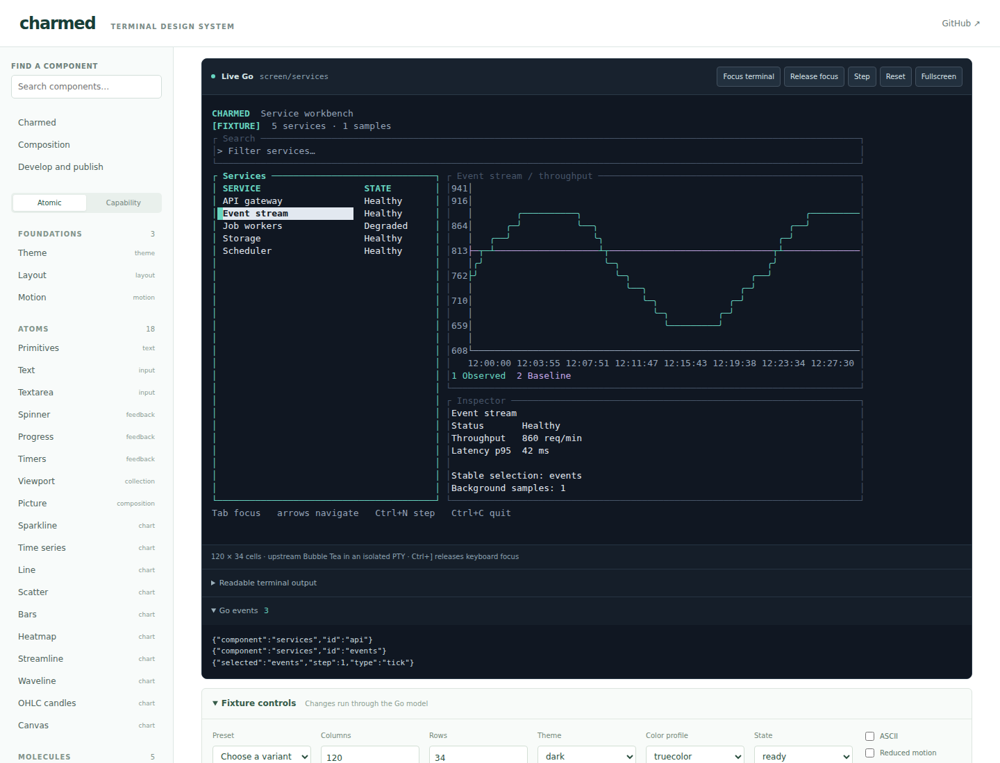

# One design language. Every terminal.

Charmed brings shared themes, cell layouts and interaction conventions to Go applications built with Charm and ntcharts. Start with a complete screen, then find its building blocks by capability.



## Read the guide

- [Foundations](foundations.html): themes, terminal geometry, focus and motion.
- [Components](components.html): inputs, collections, feedback, text and charts together in one reference.
- [Composition & examples](examples.html): ownership rules and complete native screens.
- [Compare a deployment](deployment.html): reading cohort comparisons and supplying telemetry.
- [Develop & publish](development.html): run fixtures and generate this static site.

The images and terminal frames are saved Go output. Run a fixture locally for keyboard interaction; this guide needs no JavaScript or preview service.

## Run a screen

```sh
go run ./cmd/workbench run screen/services
go run ./examples/deployment
```

The core uses upstream Charm modules, with no required fork or JavaScript runtime. Concrete upstream models remain accessible; applications own data and decisions.
